# 5주차 보고서

- 이름: 강진영
- 저장소: https://github.com/tqwuis/cg-solar
- GitHub Pages 실행: [Task 1](https://tqwuis.github.io/cg-solar/week5/task1.html) · [Task 2](https://tqwuis.github.io/cg-solar/week5/task2.html)

## Task 1

바닥과 두 개의 구가 있는 장면에 Phong 반사 모델의 **확산 반사(diffuse), 환경광(ambient), 정반사(specular)**를 순서대로 추가하고, 거리 감쇠와 법선 변환, 광원 종류에 따른 차이를 비교했다.

### 단계 1~4 — 조명을 하나씩 추가한 결과

아래는 각 단계에서 저장한 캡처 4장이다. 캡처의 잘라낸 범위와 움직이는 달·광원의 위치가 조금씩 달라, 각 조명 항을 추가했을 때 나타나는 특징을 중심으로 비교했다. 정확한 비교를 위해서는 카메라뿐 아니라 애니메이션 시간도 고정해야 한다.

#### 1단계 — 확산 반사

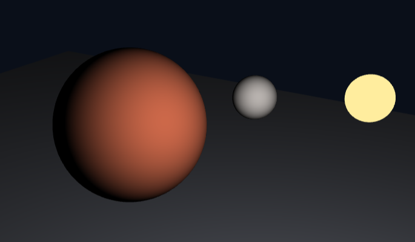

```glsl
vec3 diffuse = max(dot(N, L), 0.0) * uBaseColor * uLightColor;
fragColor = vec4(diffuse, 1.0);
```

빛을 향한 면은 밝아지고 반대쪽은 검게 보였다. 표면의 법선과 광원 방향에 따라 밝기가 달라지면서, 같은 색의 원처럼 보이던 물체에 구의 입체감이 생겼다. 확산 반사는 시선 방향을 사용하지 않으므로 광원과 물체를 고정하면 시점만 바꾸어도 표면의 밝기 자체는 변하지 않는다.

#### 2단계 — 환경광

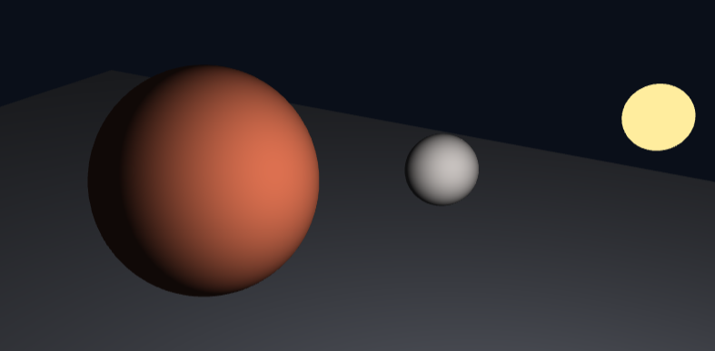

```glsl
vec3 ambient = 0.08 * uBaseColor;
fragColor = vec4(ambient + diffuse, 1.0);
```

빛을 등진 쪽에도 약한 색이 남아 물체의 윤곽을 더 쉽게 구분할 수 있다. 환경광은 주변에서 여러 번 반사되어 들어오는 빛을 상수로 근사한 것이다. 이 값을 너무 크게 하면 밝은 면과 어두운 면의 차이가 줄어 입체감이 약해진다.

#### 3단계 — 정반사

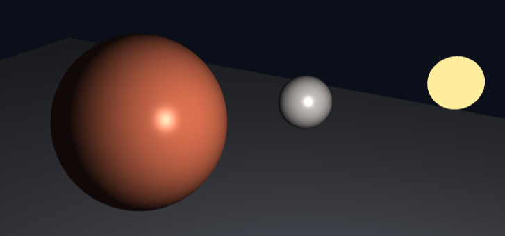

```glsl
vec3 R = reflect(-L, N);
vec3 specular = pow(max(dot(R, V), 0.0), uShininess)
              * uLightColor * 0.5;
fragColor = vec4(ambient + diffuse + specular, 1.0);
```

붉은 구와 작은 회색 구에 밝은 하이라이트가 생겼다. 정반사는 반사 방향 `R`과 시선 방향 `V`가 가까울수록 강해지므로, 시점을 움직이면 하이라이트의 위치도 달라진다. `uShininess`가 클수록 하이라이트가 좁고 날카로워지고, 작을수록 넓게 퍼진다.

#### 4단계 — 거리 감쇠

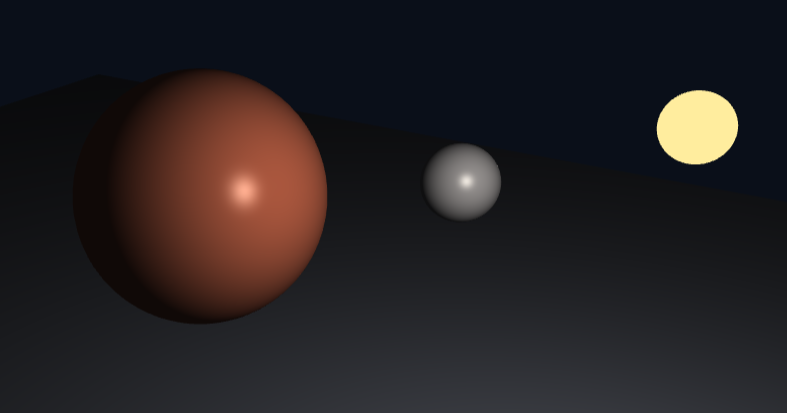

```glsl
float d = length(uLightPos - vWorldPos);
float att = 1.0 / (1.0 + 0.02 * d * d);
fragColor = vec4(ambient + (diffuse + specular) * att, 1.0);
```

광원에서 멀리 떨어진 부분의 밝기가 줄어들었다. 3단계보다 구와 바닥이 전반적으로 어둡게 보인다. 거리가 커질수록 `att`가 작아지므로 확산 반사와 정반사가 함께 약해진다.

### 단계 1 — `max`를 제거하면 어떻게 되는가?

비교할 코드는 다음과 같다.

```glsl
// max 적용
vec3 diffuse = max(dot(N, L), 0.0) * uBaseColor * uLightColor;

// max 제거
vec3 diffuse = dot(N, L) * uBaseColor * uLightColor;
```

**예측**

빛을 등진 면에서는 `dot(N, L)`이 음수가 되므로, `max`를 제거하면 확산 반사 값도 음수가 된다. 음수 밝기는 실제 빛의 세기로 해석할 수 없으며, 다른 조명 항과 더하면 그 항의 밝기를 깎는 문제가 생길 것으로 예상할 수 있다.

**실제 결과 — 단계 1 조건을 재현한 비교**

카메라를 고정한 상태에서 `max` 유무를 바꾸어 비교했으며, **화면 픽셀의 차이는 없었다.** 빛을 등진 면은 두 경우 모두 검게 보였다.

일반적인 화면 출력에서는 음수 색상이 0으로 제한되기 때문에, 확산 반사만 출력하는 1단계에서는 차이가 드러나지 않은 것이다. 그러나 셰이더 내부의 음수 값까지 사라진 것은 아니다. 이후 환경광이나 다른 광원의 밝기와 합산하면 그 값을 상쇄할 수 있으므로, 빛을 등진 면의 확산 반사를 0으로 만드는 `max`는 유지해야 한다.

### 단계 5 — 비균등 스케일에서 모델 행렬과 법선 행렬 비교

구의 크기를 다음과 같이 바꾸어 세로로 길게 늘린 상태에서 비교했다.

```javascript
m = Mat4.multiply(m, Mat4.scale(0.7, 2.2, 0.7));
```

#### 모델 행렬 `mat3(uModel)` 사용

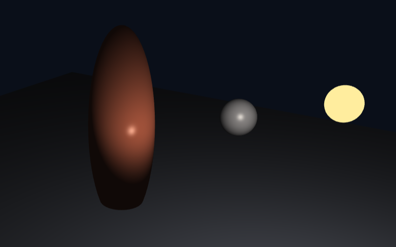

```glsl
vNormal = mat3(uModel) * aNormal;
```

캡처에서는 하이라이트가 구의 중앙 부근에 작게 나타났다. 비균등 스케일에서 법선에 모델 행렬을 그대로 곱하면, 법선도 물체와 같은 비율로 늘어나 변형된 표면과 수직인 방향을 유지하지 못한다. 그 결과 확산 반사의 밝은 영역과 정반사의 위치가 틀어질 수 있다.

#### 법선 행렬 `uNormalMat` 사용

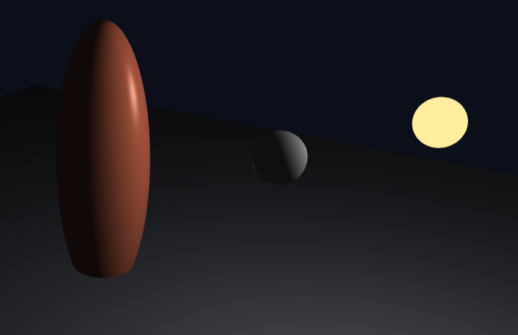

```glsl
vNormal = uNormalMat * aNormal;
```

법선 행렬은 모델 행렬의 역전치 행렬에서 좌상단 3×3 부분을 사용한다. 프래그먼트 셰이더에서는 보간된 법선을 `normalize(vNormal)`로 다시 정규화한다.

제공된 법선 행렬 캡처에서는 하이라이트가 오른쪽 위로 길게 나타나며 밝은 영역의 분포도 달라졌다. 비균등 스케일에서 법선을 올바르게 변환하려면 **모델 행렬을 그대로 쓰는 대신 역전치 법선 행렬을 사용해야 한다**는 점이 핵심이다.

### 단계 6 — 광원 종류를 바꾼 결과

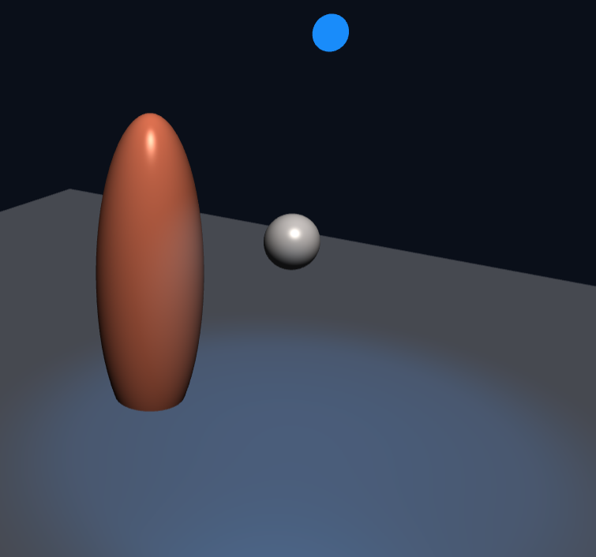

주광원의 방향 계산을 점광원에서 방향광으로 바꾸었다.

```glsl
// 점광원: 표면 위치마다 광원 쪽 방향이 다르다.
vec3 L = normalize(uLightPos - vWorldPos);

// 방향광: 모든 표면에서 같은 광원 방향을 사용한다.
vec3 L = normalize(vec3(0.4, 0.8, 0.5));
```

추가한 파란색 스포트라이트는 다음과 같이 원뿔 안쪽만 비추도록 했다.

```glsl
vec3 fromSpot = normalize(vWorldPos - uSpotPos);
float spotCos = dot(normalize(uSpotDir), fromSpot);
float spotFactor = smoothstep(
  cos(radians(42.0)), cos(radians(28.0)), spotCos
);
```

점광원은 표면 위치마다 빛의 방향과 광원까지의 거리가 달라지지만, 방향광은 모든 위치에서 같은 방향의 빛을 받는다. 

방향광이 전체적인 밝고 어두운 면을 결정하고 스포트라이트가 원뿔 안쪽을 선택적으로 비춘다는 차이를 볼 수 있다.

## Task 2

### 의도 — 어떤 장면과 분위기를 만들려 했는가

차갑고 어두운 빙하 동굴 안에서 깊은 안쪽을 바라보는 장면을 만들고 싶었다. 입구에서 들어오는 푸른 달빛, 얼음 결정에서 퍼지는 청록색 빛, 천장 틈새에서 내려오는 빛을 함께 배치해 차갑고 고요한 분위기를 표현했다.

### 방법 — 광원과 재질을 어떻게 구성했는가

#### 기존 메시 활용

Task 1의 구 메시를 늘리고 회전시켜 빙벽, 천장, 고드름, 얼음 결정, 바위를 만들었다. 같은 구 생성 함수를 사용하되 일부는 분할 수를 줄이고 삼각형별 법선을 계산해 각진 얼음처럼 보이게 했다. 바닥은 기존 평면 메시를 길게 늘려 사용했다. 천장의 얼음 덩어리와 고드름 일부를 옆으로 이동시켜 빛이 들어오는 틈도 만들었다.

#### 광원 배치

광원은 **방향광 1개, 점광원 1개, 스포트라이트 1개로 총 3개**를 사용했다. 버튼과 숫자 키 `1`, `2`, `3`으로 각각 켜고 끌 수 있다. 좌표는 모두 월드 좌표이며, 위쪽은 `+y` 방향이다.

| 번호 | 표현하려는 빛 | 종류 | 위치 또는 방향 | 색과 역할 |
| --- | --- | --- | --- | --- |
| 1 | 입구의 달빛 | 방향광(directional light) | 관찰자 뒤의 입구 쪽인 `+z`에서 동굴 안쪽인 `-z`로 진행한다. 방향광은 시간에 따라 방향이 바뀐다. | 푸른색 `(0.075, 0.14, 0.32)`. 빙벽과 고드름의 넓은 면을 비춰 동굴의 전체적인 윤곽을 만든다. |
| 2 | 얼음 결정의 빛 | 점광원(point light) | 왼쪽 얼음 결정 가까이인 `(-2.65, 1.65, -5.15)`에 고정했다. | 청록색 `(0.22, 2.25, 3.2)`. 가까운 결정과 벽, 바닥을 밝히고 거리가 멀어질수록 약해진다. |
| 3 | 천장 틈새의 빛 | 스포트라이트(spot light) | 천장 틈 위인 `(1.35, 8.3, -6.4)`에 하나만 두고, 아래쪽 바닥을 향해 좌우로 움직이게 했다. | 옅은 청백색에서 진한 보라색으로 변했다가 돌아온다. 바닥의 제한된 영역과 그 주변 물체를 강조한다. |

표의 광원색은 색상과 세기를 함께 나타내므로 일부 성분이 1보다 크다. 마지막에 톤 매핑과 감마 보정을 적용해 화면에 표시했다.

방향광은 모든 표면에서 같은 방향 벡터를 사용하며 거리 감쇠를 적용하지 않았다. 점광원과 스포트라이트에는 각각 거리에 따른 감쇠를 적용했다. 스포트라이트는 안쪽 각도 `13°`, 바깥쪽 각도 `24°` 사이에서 빛이 부드럽게 줄어들도록 했다. 방향은 `[0.17 * sin(phase), -1.0, 0.22]`로 계산해 바닥에 닿는 중심이 앞뒤로 움직이지 않고 좌우로만 이동하게 했고, 색과 세기도 **12초 주기**로 변하도록 했다.


#### 재질 구분

물체마다 기본 색, `uShininess`, 정반사 계수 `uSpecular`를 다르게 설정했다. `uShininess`는 하이라이트의 폭을, `uSpecular`는 정반사의 세기를 조절한다.

| 재질 | 기본 색 RGB | `uShininess` | `uSpecular` | 표현하려는 차이 |
| --- | --- | --- | --- | --- |
| 빙벽 | `(0.20, 0.39, 0.56)` | 72 | 0.42 | 푸른색의 단단한 얼음 벽 |
| 어두운 얼음 | `(0.095, 0.22, 0.34)` | 96 | 0.55 | 빙벽 사이의 짙은 얼음 덩어리 |
| 얼음 결정 | `(0.33, 0.70, 0.78)` | 160 | 0.95 | 작고 강한 하이라이트가 생기는 매끈한 결정 |
| 얼음 바닥 | `(0.10, 0.22, 0.31)` | 128 | 0.80 | 빛을 받아 반짝이는 얼어붙은 바닥 |
| 암석 | `(0.085, 0.105, 0.14)` | 6 | 0.07 | 어둡고 광택이 약한 바위 |
| 눈 | `(0.47, 0.58, 0.64)` | 12 | 0.10 | 밝은 색이지만 정반사는 약한 눈 |

같은 조명을 받아도 얼음 결정과 바닥에는 뚜렷한 하이라이트가 생기고, 바위는 상대적으로 어둡고 무광으로 보이도록 했다.

### 광원을 하나씩 끈 비교

#### 1번 방향광을 끈 상태 — 점광원과 스포트라이트만 켬

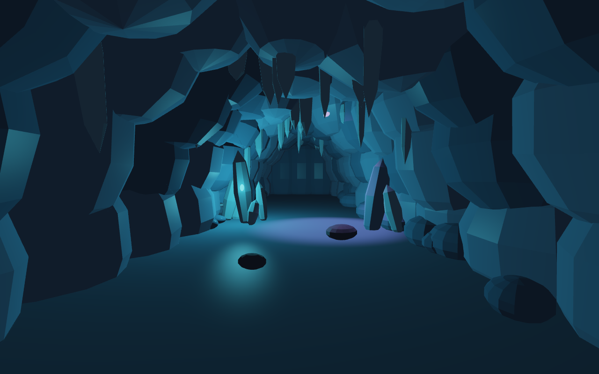

가까운 천장의 고드름과 앞쪽 빙벽, 오른쪽 앞의 바위가 더 어두워졌다. 왼쪽 결정 주변의 청록색 빛과 바닥의 보랏빛은 남아 있지만, 장면 전체의 넓은 면을 비추던 달빛이 사라져 윤곽을 구분하기 어려워진다. 방향광은 국소적인 강조보다 동굴의 전체 형태를 드러내는 역할을 한다.

#### 2번 점광원을 끈 상태 — 방향광과 스포트라이트만 켬

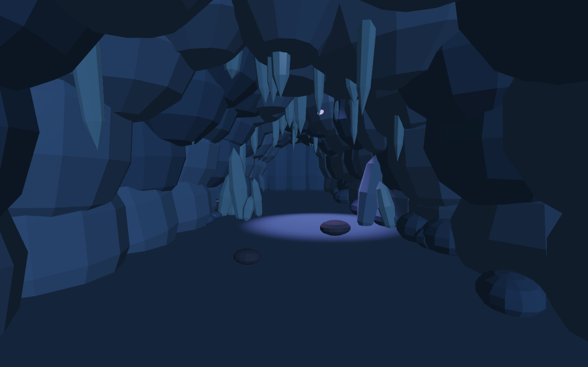

왼쪽 얼음 결정의 밝은 청록색과 주변 벽의 반짝임이 크게 줄었다. 앞쪽 바닥에 있던 청록색 하이라이트도 사라지고, 푸른 달빛과 스포트라이트의 보랏빛이 주로 남는다. 점광원은 결정 가까운 곳을 강하게 비춰 장면 안의 시선을 모으는 역할을 한다.

#### 3번 스포트라이트를 끈 상태 — 방향광과 점광원만 켬

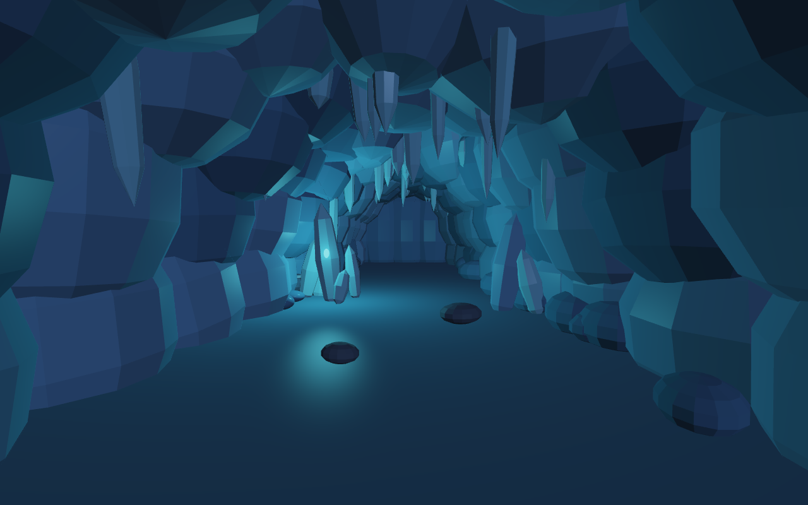

중앙에서 오른쪽으로 이어지는 바닥의 보랏빛 영역과 그 위 바위의 밝은 면이 사라졌다. 빙벽의 푸른 윤곽과 왼쪽 결정의 청록색은 남지만, 천장에서 특정 지점으로 빛이 내려오는 느낌이 약해진다. 스포트라이트는 원뿔 안쪽의 좁은 영역을 비춰 바닥에 밝은 초점을 만드는 역할을 한다.

#### 광원 하나씩만 켠 캡처

| 켜진 광원 | 단독 캡처 | 확인할 부분 |
| --- | --- | --- |
| 1번 방향광만 켬 | [방향광 단독 캡처](images/task2-lights-1-off-off.png) | 동굴의 넓은 면과 윤곽을 비추는 푸른빛 |
| 2번 점광원만 켬 | [점광원 단독 캡처](images/task2-lights-off-2-off.png) | 왼쪽 결정 주변에 집중되는 청록색 빛과 거리 감쇠 |
| 3번 스포트라이트만 켬 | [스포트라이트 단독 캡처](images/task2-lights-off-off-3.png) | 어두운 바닥의 한 영역을 선택적으로 비추는 빛 |

### 최종 결과 — 세 광원을 모두 켠 상태

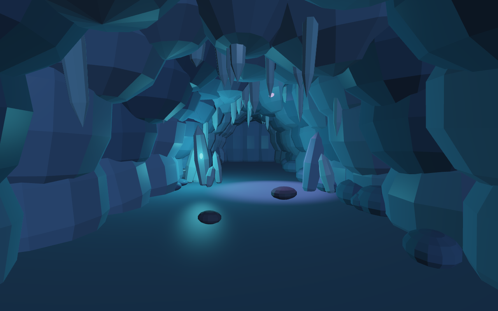

달빛으로 빙벽과 고드름의 윤곽을 드러내고, 청록색 점광원으로 왼쪽 결정을 강조했으며, 보랏빛 스포트라이트로 바닥에 밝은 영역을 만들었다. 세 광원의 색과 비추는 범위가 겹치면서 같은 얼음 재질도 위치에 따라 다른 인상을 준다. 실행 중에는 방향광의 방향과 스포트라이트의 좌우 방향·색이 변해, 정지 캡처와 달리 밝은 영역이 천천히 이동한다.

### AI 사용 — 무엇을 요청했고 무엇을 고쳤는가

구현과 보고서 초안 정리에 **Codex**를 사용했다. 장면의 주제는 차갑고 어두운 빙하 동굴로 정하고, 기존 구와 평면 메시를 최대한 활용하도록 요청했다. 이후 결과를 보면서 조명의 역할과 표현 방식을 구체적으로 수정했다.

| 요청 또는 확인한 문제 | 실제 반영 내용 |
| --- | --- |
| 기존 메시를 활용해 빙하 동굴을 만들기 | 구의 크기·회전·위치를 바꿔 빙벽, 천장, 고드름, 결정과 바위를 배치하고 평면을 바닥으로 사용했다. |
| 각 광원이 무엇을 표현하는지 분명하게 하기 | 입구의 달빛은 방향광, 결정의 빛은 점광원, 천장 틈새의 빛은 스포트라이트로 나누고 버튼에 역할과 종류를 함께 표시했다. |
| 방향광은 관찰자 뒤에서 동굴 안으로 들어오고 시간에 따라 방향이 바뀌게 하기 | 입구 쪽에서 들어오는 방향을 유지하며 월드 좌표의 방향 벡터가 변하도록 했다. |
| 천장 틈새에서 빛이 들어오는 느낌 만들기 | 천장 메시와 고드름 일부를 옮겨 실제 틈을 만들고 그 위에 스포트라이트를 배치했다. |
| 과제의 Phong 반사 모델에 집중하기 | 별도 빛줄기 셰이더, 절차적 무늬와 법선 변형, 안개 효과를 제거했다. 표면 조명은 Phong 모델을 사용하고 톤 매핑과 감마 보정은 유지했다. |
| 스포트라이트는 하나만 사용하고, 색이 옅어졌다 진해지는 변화를 반복하기 | 스포트라이트와 발광 표시를 각각 하나로 정리하고 12초 주기의 색·세기 변화를 적용했다. |
| 스포트라이트가 원형으로 보이지 않는 문제 확인 | 원뿔 영역을 사각형으로 자르던 틈 마스크를 제거하고 원뿔 범위와 거리 감쇠로 밝기를 계산하도록 했다. |
| 스포트라이트의 움직임을 상하에서 좌우로 바꾸기 | 방향 벡터의 `y`, `z` 성분을 고정하고 `x` 성분만 주기적으로 바꾸었다. |
| 화면 인터페이스를 간단하게 만들기 | 광원 토글 버튼 3개와 처음 시점 버튼만 남겼다. |

PBR이나 레이트레이싱을 사용하지 않고, 광원마다 같은 Phong 확산·정반사 계산을 반복해 합산하는 방식으로 구성했다. 보고서에는 현재 코드의 광원 위치·색·재질 값을 확인해 정리하고, 기존 단독 광원 캡처와 별도로 한 광원씩 끈 비교 캡처와 최종 캡처를 추가했다.
