# 6주차 보고서

- 이름: 강진영
- 저장소: https://github.com/tqwuis/cg-solar
- GitHub Pages 실행: [Task 1](https://tqwuis.github.io/cg-solar/week6/week06-material-starter/task1.html) · [Task 2 배포 후 실행 주소](https://tqwuis.github.io/cg-solar/week6/week06-material-starter/task2.html)

## Task 1

큐브에 **색상 텍스처, PBR 직접광, ARM 맵, 노멀 맵, 환경맵 반사**를 순서대로 적용하고, 단계별 화면과 녹슨 금속의 재질 차이를 비교했다. 구현 코드는 [task1.js](week06-material-starter/task1.js)에 있다.

### 단계 1~5 — 같은 시점 비교

화면에 표시된 설정은 roughness 배율 `1`, metallic 배율 `1`, normal 강도 `5`, 직접광 세기 `4`, 상수 ambient `0.15`, 환경맵 반사 세기 `1.5`이다. 다만 해당 기능을 구현하기 전에는 슬라이더 값이 표시되어 있어도 결과에 반영되지 않는다.

1·2·3·5단계는 나무 재질이고, 노멀 맵을 확인하기 위해 4단계는 돌 재질이다.

#### 1단계 — 색상 텍스처

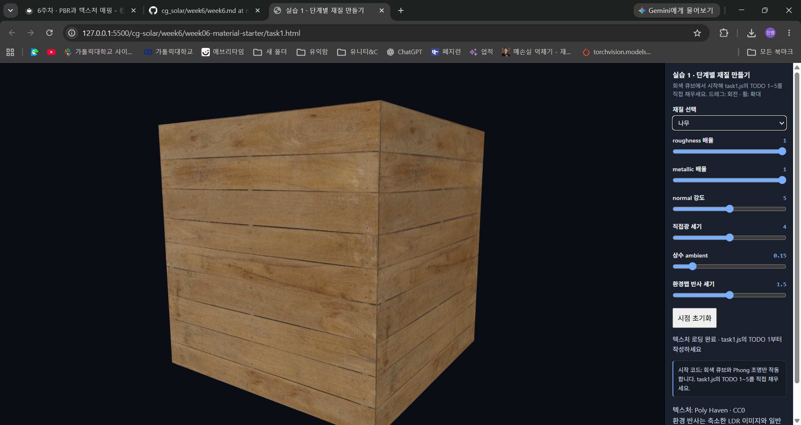

```glsl
base = srgbToLinear(texture(uColor, vUV).rgb) * uTint;
```

큐브 표면에 나뭇결과 판자 사이의 검은 선이 나타났다. 앞면은 밝고 오른쪽 면은 조금 어두워 큐브의 형태가 구분된다. 이 단계의 나뭇결은 색상 무늬이며, 노멀 맵으로 표면의 법선을 바꾸기 전이므로 무늬에 따른 굴곡을 조명 계산에 반영하지는 않는다.

색상 텍스처는 sRGB에서 선형 공간으로 바꾼 뒤 조명 계산에 사용했다. 최종 색상은 톤 매핑 후 다시 sRGB로 변환해 화면에 표시한다.

#### 2단계 — PBR 직접광

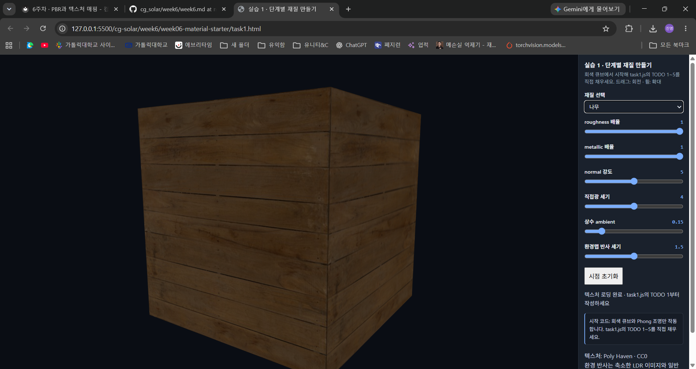

```glsl
vec3 H = normalize(V + L);
float nl = max(dot(N,L),0.0), nv = max(dot(N,V),0.0);
float nh = max(dot(N,H),0.0), vh = max(dot(V,H),0.0);
float a = rough*rough, a2 = a*a;
float den = nh*nh*(a2-1.0)+1.0;
float D = a2 / max(PI*den*den, 1e-6);
float k = (rough+1.0)*(rough+1.0)/8.0;
float G = (nl/(nl*(1.0-k)+k)) * (nv/(nv*(1.0-k)+k));
vec3 F0 = mix(vec3(0.04), base, metal);
vec3 F = F0 + (1.0-F0)*pow(1.0-vh,5.0);
vec3 kd = (1.0-F)*(1.0-metal);
return (kd*base/PI + D*G*F/max(4.0*nl*nv,1e-4))*nl*uPower;
```

Phong 조명을 GGX 법선 분포 `D`, Schlick 프레넬 `F`, Smith-Schlick 기하 감쇠 `G`를 사용하는 PBR 직접광으로 바꾸었다. 캡처에서는 1단계보다 큐브 전체가 어두운 갈색으로 보인다.

이 단계에서는 아직 ARM 맵을 읽지 않아 `metal = uMetal`을 그대로 사용한다. metallic 값이 `1`이므로 나무 무늬에도 금속의 반사 특성이 적용되고, `kd`가 0이 되어 확산 반사가 사라진다. 따라서 이 화면의 어두워진 결과는 PBR 자체가 항상 어둡기 때문이 아니라, 당시 적용한 금속성·거칠기와 조명 조건에 따른 결과이다.

#### 3단계 — ARM 맵

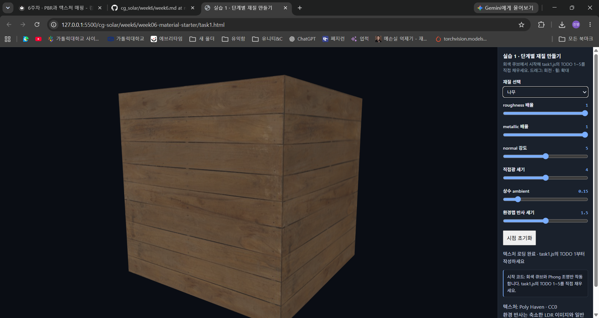

```glsl
vec3 arm = texture(uARM, vUV).rgb;
ao = arm.r;
rough = max(arm.g*uRough, 0.045);
metal = arm.b*uMetal;
```

ARM 맵의 R은 AO, G는 roughness, B는 metallic 값으로 사용했다. 이 값들은 색이 아닌 수치 데이터이므로 sRGB 변환을 적용하지 않았다.

2단계보다 나무 표면이 밝아지고 나뭇결을 구분하기 쉬워졌다. 이제 metallic 슬라이더는 표면 전체의 금속성을 직접 지정하는 값이 아니라 **맵 값에 곱하는 배율**이다. 배율이 `1`이어도 나무의 비금속 영역은 낮은 금속성을 유지하므로 확산 반사가 살아난다. 거칠기도 위치별 맵 값으로 달라지며, AO는 코드에서 상수 ambient와 이후 환경맵 반사에 곱해진다.

#### 4단계 — 노멀 맵

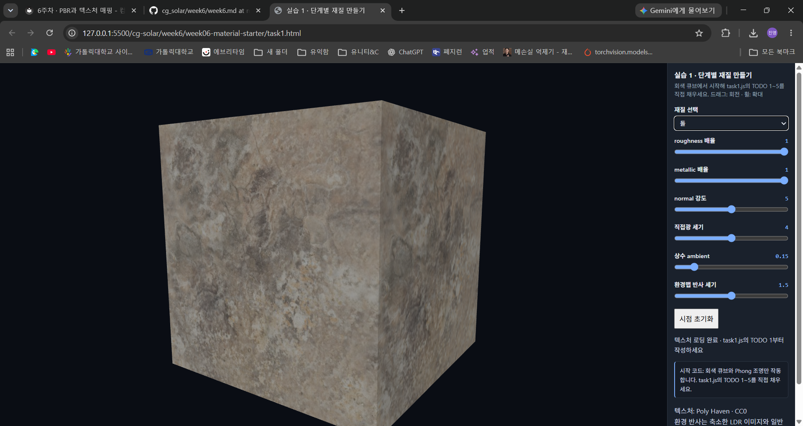


```glsl
vec3 mapN = texture(uNormal, vUV).xyz*2.0-1.0;
mapN.xy *= uNormalStrength;
N = normalize(mat3(T*inv, B*inv, N)*normalize(mapN));
```

돌 재질에서는 밝고 어두운 작은 얼룩이 이어져 표면이 거칠게 보인다. 두 번째 캡처는 첫 번째보다 오른쪽 면의 명암 변화가 더 두드러져 울퉁불퉁한 느낌이 강하다. 두 캡처 모두 normal 강도는 `5`로 표시되어 있으므로, 이미지 자체만으로 normal 강도 0과 5의 비교라고 볼 수는 없다.

노멀 맵의 RGB를 `-1~1` 범위의 접선 공간 법선으로 바꾸고, 위치와 UV의 미분으로 만든 TBN을 이용해 조명 계산에 사용할 법선으로 변환했다. 표면의 작은 부분마다 빛을 받는 방향이 달라지지만, 정점을 이동한 것은 아니므로 큐브의 모서리와 외곽선은 그대로 유지된다.

#### 5단계 — 환경맵 반사

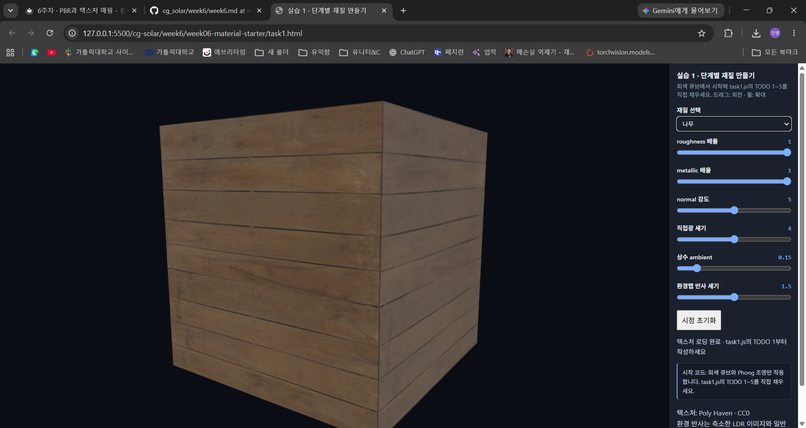

```glsl
vec3 reflected = reflect(-V, N);
vec2 envUV = vec2(atan(reflected.z, reflected.x)/(2.0*PI)+0.5,
                  asin(clamp(reflected.y, -1.0, 1.0))/PI+0.5);
vec3 envColor = srgbToLinear(textureLod(uEnv, envUV, rough*7.0).rgb);
vec3 envF0 = mix(vec3(0.04), base, metal);
color += uEnvPower * ao * envColor * envF0;
```

나무 재질로 돌아와 확인한 결과, 3단계보다 오른쪽 면이 옅고 밝게 보인다. 3단계 이후 노멀 맵과 환경맵 반사가 모두 추가되었으므로 두 캡처의 차이에는 두 기능의 영향이 함께 포함된다.

환경맵은 시선의 반사 방향 `reflect(-V, N)`에 해당하는 주변 이미지를 읽어 표면에 더한다. 모든 방향에 같은 값을 더하는 상수 ambient와 달리, 시선과 표면 법선에 따라 반사되는 환경의 위치가 달라진다. 거칠기가 클수록 높은 mip 레벨을 읽어 반사를 흐리게 표현했다. 나무는 비금속이므로 정면 반사율이 약 `0.04`로 작아, 선명한 거울상보다는 약한 반사 밝기가 더해진다.

### 금속 영역과 녹 영역의 차이

#### metallic 배율 1 — ARM 맵의 금속성 유지

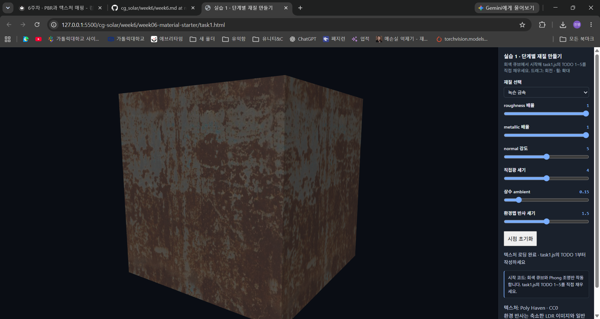

회색 금속 영역과 붉은 갈색의 녹 영역이 같은 큐브 안에서 구분된다. 금속 영역은 정반사 중심으로 빛을 반사하고, 녹 영역은 비금속으로 취급되어 갈색의 확산 반사 성분을 유지한다. 이 캡처의 금속 영역은 밝은 거울처럼 빛나기보다는 비교적 어두운 회색으로 보인다. 금속이라고 항상 밝게 보이는 것은 아니며, 반사 방향에 있는 환경과 거칠기에 따라 밝기가 달라진다.

#### metallic 배율 0 — 전체를 비금속으로 처리

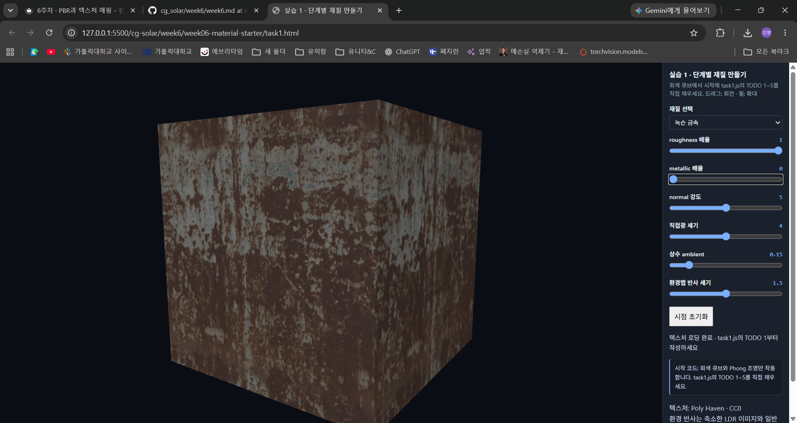

같은 시점에서 metallic 배율을 `0`으로 낮추자 회색 영역이 더 밝고 희게 보였다. 색상 텍스처는 그대로여서 녹의 무늬와 위치는 유지되지만, 원래 금속이던 부분에도 확산 반사가 생겨 표면의 인상이 달라진다. 갈색 녹 영역은 회색 금속 영역에 비해 변화가 작다.

```glsl
metal = arm.b*uMetal;
vec3 F0 = mix(vec3(0.04), base, metal);
vec3 kd = (1.0-F)*(1.0-metal);
```

| 비교 항목 | 금속 영역 | 녹 영역 |
| --- | --- | --- |
| 색상 | 회색 계열의 금속 표면 | 붉은 갈색의 녹 무늬 |
| 금속성 | ARM 맵의 metallic 값이 높은 영역 | metallic 값이 낮은 비금속 영역 |
| 확산 반사 | 금속성이 1에 가까울수록 줄어든다. | 확산 반사로 갈색 무늬가 드러난다. |
| 정반사색 | `F0`가 기본 색 `base`에 가까워진다. | `F0`가 약 `0.04`인 무채색 반사를 사용한다. |
| metallic 배율을 0으로 바꾼 결과 | 회색 영역이 더 밝아지고 비금속처럼 보인다. | 원래 금속성이 낮아 상대적으로 변화가 작다. |

두 캡처에서 roughness 배율은 모두 `1`이다. 거칠기 맵은 그대로 유지되므로, 이 비교는 거칠기를 바꾼 결과가 아니라 금속성에 따른 확산 반사와 정반사의 비중 변화를 보여준다. **색상 텍스처가 같아도 metallic 값에 따라 재질의 느낌이 달라진다.**

## Task 2

### 빙각의 궤도

단색 태양은 타원의 한 초점에 고정되어 있고, 얼음행성 **빙각**이 그 주위를 공전하며 자전한다. 3주차에 의도한 풍경은 차가운 바다 위를 떠다니는 빙하와 간헐적으로 나타나는 오로라였다. 3주차의 푸른 얼음·눈·극관 색과 높이 잡음을 다시 사용하고, PBR 조명 아래에서도 밝은 빙판의 윤곽이 드러나도록 했다. [3주차 설계와 원래 캡처](../week3/week3.md#행성-1) · [실행 파일](week06-material-starter/task2.html) · [공전 위치 계산](week06-material-starter/task2.js#L202)

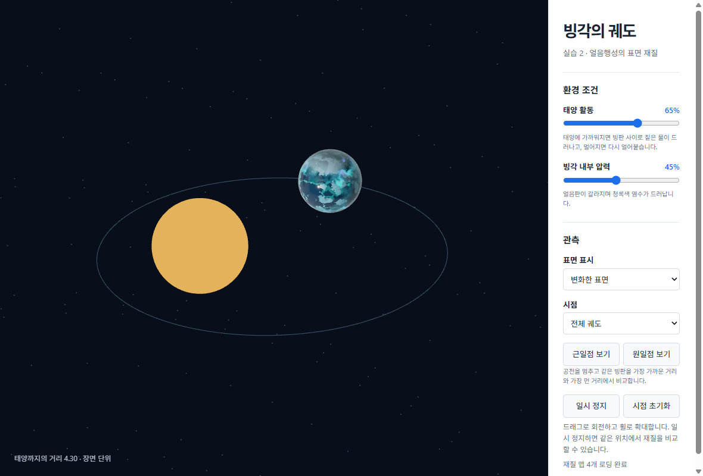

큰 얼음 지형은 행성에 붙어 자전하고, 그 위의 밝은 빙판은 더 촘촘한 3차원 잡음을 천천히 이동시켜 표류하는 모습을 낸다. 오로라는 중위도와 극지 사이로 오르내리는 띠에 청록·보라색 발광을 더한 것이다. 경도마다 띠의 위치와 밝은 부분이 다르고 시간이 흐르면 띠 전체가 사라졌다 다시 나타난다. 아래 세 장은 모두 원일점에서 촬영했다. [빙판 무늬](week06-material-starter/task2.js#L123) · [오로라의 위치와 점멸](week06-material-starter/task2.js#L91)

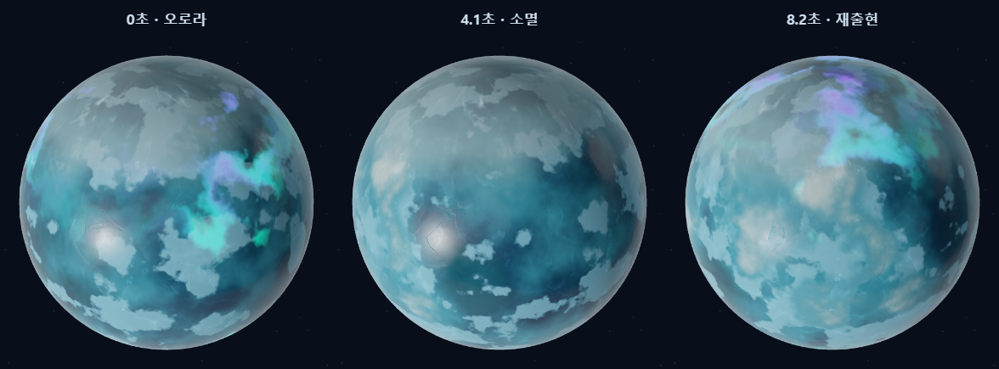

### 태양 거리와 해빙

**원일점 보기**와 **근일점 보기**를 번갈아 누르면 공전·자전·빙판·오로라 시간이 멈춘 채 같은 지역을 확대한다. 공전 재생을 누르면 선택한 위치에서 이어진다.

태양 활동 65%, 내부 압력 45%로 고정했다. 원일점에서는 푸른 얼음 사이의 밝은 빙판과 서리 결이 넓게 보인다. 근일점에서는 낮은 곳부터 얼음이 녹아 남색 물이 드러난다. 물 위의 반사점은 작고 선명하고, 아직 녹지 않은 두꺼운 빙판은 윤곽을 유지한다.

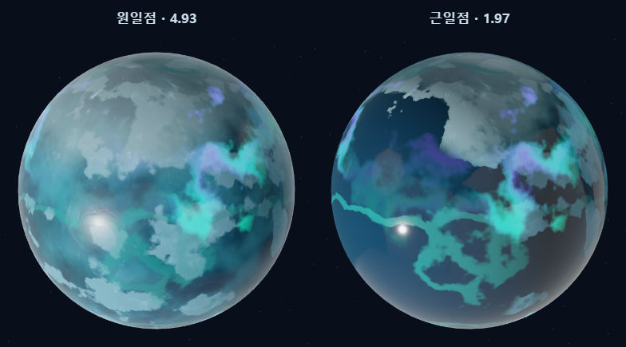

해빙에는 두 천체의 중심 거리 `r`을 사용한다. `1/r²`을 원일점 0, 근일점 1로 정규화한 뒤 제곱근을 취해 공전 중간에도 변화가 보이게 했다. 표면별로 일조 방향, 지형 높이, 위도, 빙판 두께를 반영해 녹기 시작하는 문턱을 다르게 둔다. 아래 확대 화면에서 원반 내부를 표본으로 삼아 해빙 마스크가 절반 이상 켜진 픽셀을 세면, 원일점(거리 4.93)은 약 **2%**, 근일점(거리 1.97)은 약 **72%**다. 이 비율은 캡처에 보이는 면의 값이다. [거리 계산](week06-material-starter/task2.js#L312) · [해빙 마스크](week06-material-starter/task2.js#L84)

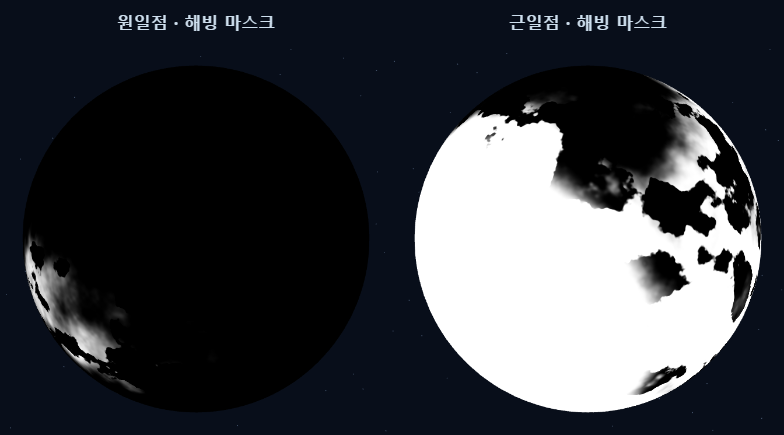

### 독립적인 두 조건

| 조건 | 마스크와 재질 변화 |
| --- | --- |
| 태양 활동 | 활동을 높이면 태양을 향한 면과 낮은 빙판부터 녹는다. 물이 깊어지면서 청록색에서 남색으로 바뀌고 roughness는 0.10에 가까워진다. 태양의 표시 밝기와 직접광 세기도 함께 변한다. [해빙 규칙](week06-material-starter/task2.js#L84) |
| 빙각 내부 압력 | 압력이 오르면 로컬 좌표에서 계산한 두 방향의 단층이 벌어져 청록색 염수가 드러난다. 겹치는 곳은 염수의 색과 roughness 0.21을 마지막에 적용한다. [균열 규칙](week06-material-starter/task2.js#L106) · [재질 혼합](week06-material-starter/task2.js#L149) |

**태양 활동 0·50·100%**. 근일점에서 내부 압력을 0%로 고정했다. 단계가 올라갈수록 물이 드러나는 영역이 늘고, 같은 지점의 얼음결이 사라지면서 반사점이 좁아진다.

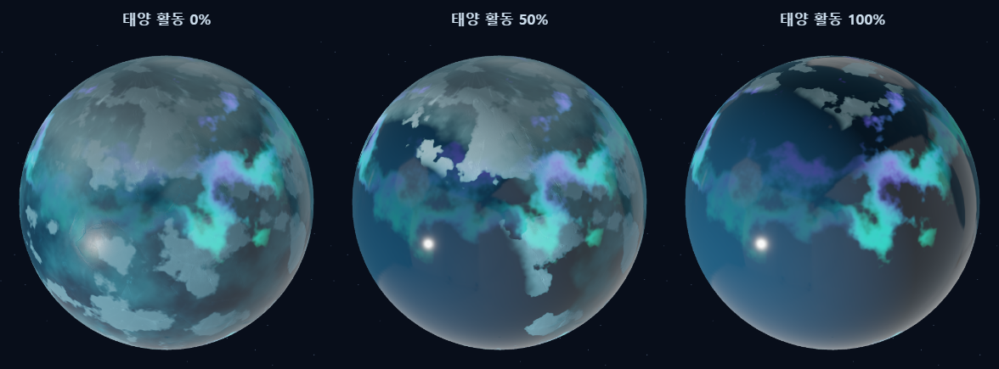

**내부 압력 0·50·100%**. 근일점에서 태양 활동을 50%로 고정했다. 해빙 영역은 그대로이고 청록색 단층만 넓어진다.

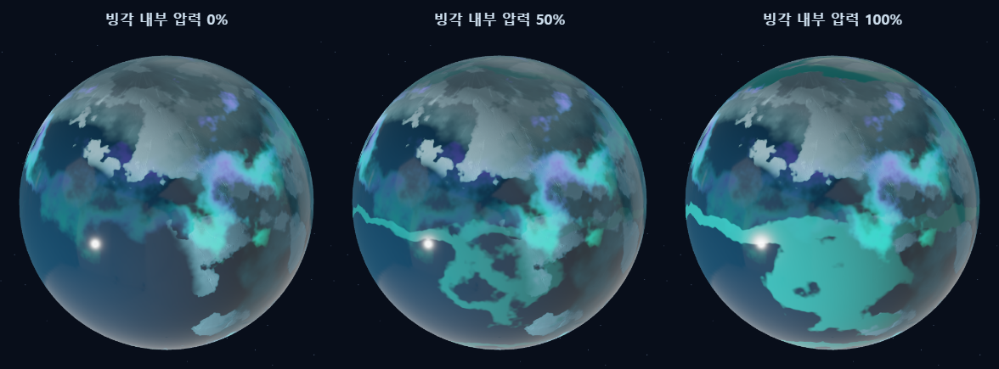

### 두 마스크와 기본 표면 비교

거리 3.01, 태양 활동 65%, 압력 80%에서 두 마스크를 각각 출력했다. 검정은 가중치 0이고 흰색은 1이다. 해빙 경계는 태양 쪽에 생기고, 균열은 얼음판을 따라 다른 무늬로 이어진다.

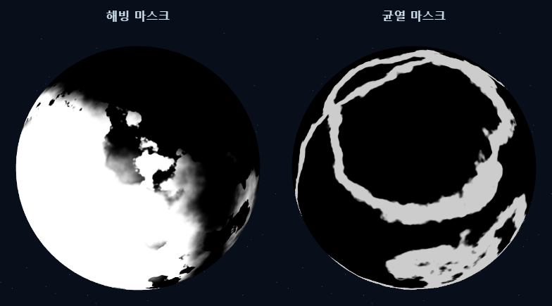

아래는 근일점에서 같은 활동·압력으로 본 기본 표면과 변화한 표면이다. 기본 표면에서는 두 마스크의 재질 가중치만 0으로 두므로 조명과 오로라는 두 화면에서 같다. 얼음과 염수는 모두 비금속으로 처리했다.

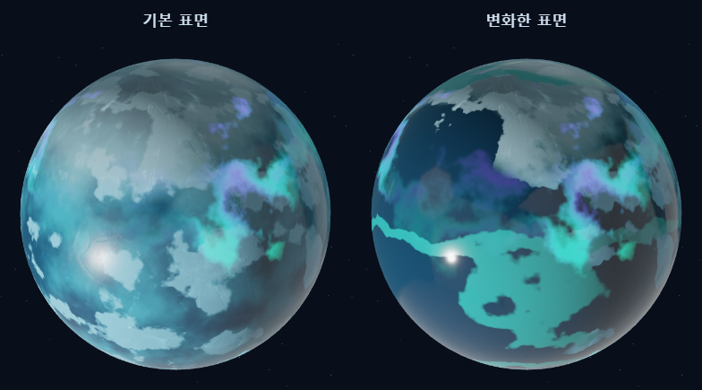

### AI 구현에서 수정·검증한 부분

- 거리 변화가 약했던 초기 셰이더를 수정해 타원의 실제 근일점과 원일점을 해빙 규칙의 양 끝으로 사용했다. 두 위치에서 카메라를 태양–행성 축 기준으로 맞추고 자전 시각을 고정해 같은 빙판을 비교했다.
- 3주차 균열 수식의 역순 `smoothstep`을 `1.0 - smoothstep(0.52, 0.68, terrain)`으로 바꿔 같은 방향으로 값이 줄어들도록 했다. 오로라와 빙판의 움직임에는 공전 재생과 같은 시계를 사용한다.
- 로컬 Chrome의 WebGL 2에서 태양 활동과 압력을 각각 0·50·100%로 바꾸어 한 마스크의 밝기가 단계적으로 증가하고 다른 마스크 픽셀은 그대로인지 확인했다. 색상·노멀·ARM·환경 맵도 로컬 파일에서 정상적으로 로드되었다.

### 재질 맵 출처

빙판에는 ambientCG의 **Ice 003** 1K 세트를 사용했다. Color 맵은 sRGB에서 선형 색으로 바꾼 후 밝기 무늬만 사용해 3주차 색을 살렸다. NormalGL은 얼음의 가는 요철에 사용하고 녹은 물에서는 강도를 낮춘다. Roughness는 ARM의 G에 넣었다. 원본에 AO 맵이 없어 R은 1, 비금속인 얼음의 B는 0으로 채웠다. 환경 반사는 기존 Poly Haven **Studio Small 09**의 LDR 이미지를 사용한다. 두 에셋은 CC0이다. [Ice 003](https://ambientcg.com/view?id=Ice003) · [ambientCG 라이선스](https://docs.ambientcg.com/license/) · [Studio Small 09](https://polyhaven.com/a/studio_small_09) · [파일별 출처](week06-material-starter/assets/week06/sources.json)
