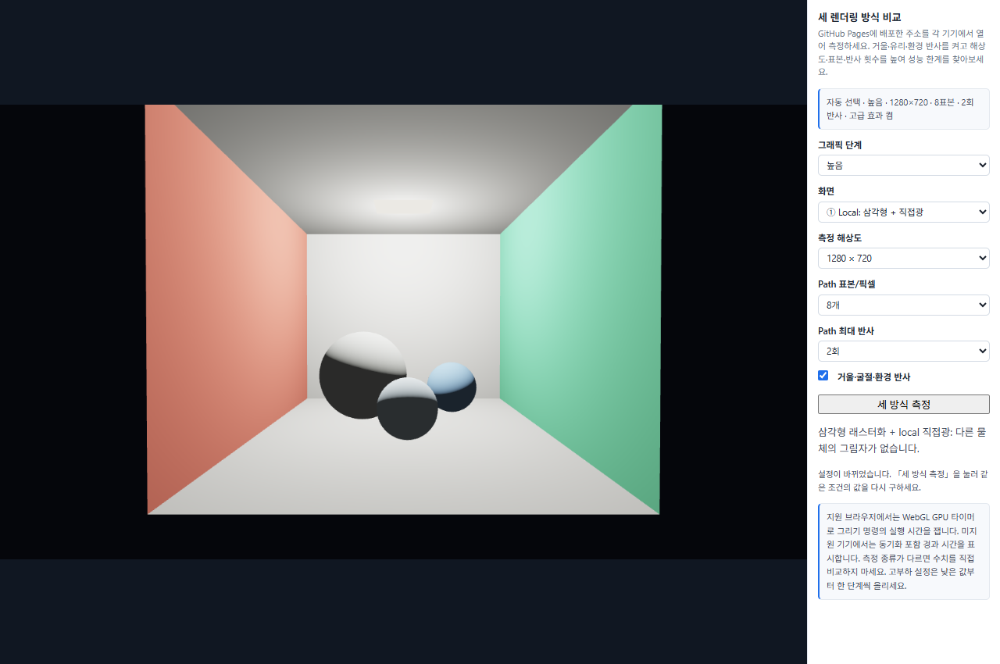
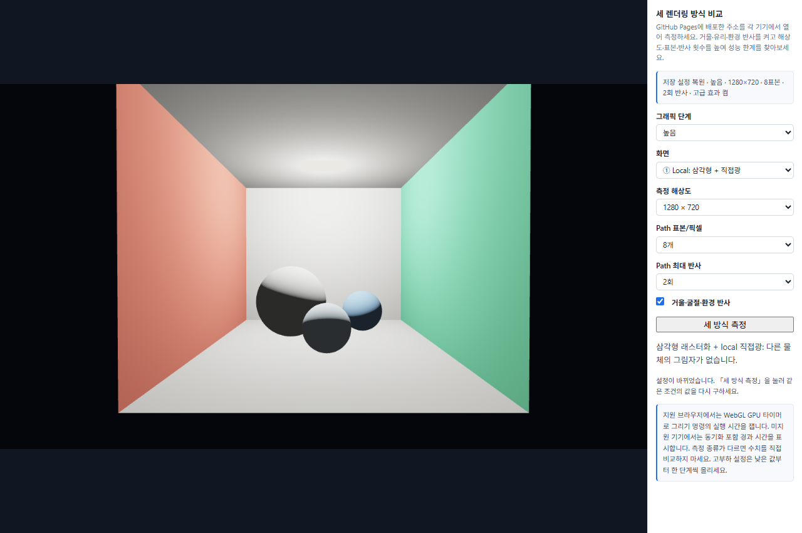

# 7주차 보고서

- 이름: 강진영
- 저장소: https://github.com/tqwuis/cg-solar
- GitHub Pages 실행: [Task 1](https://tqwuis.github.io/cg-solar/week7/week07-raytrace-starter/task1.html)

## Task 1

광선 추적으로 **일식과 월식**을 렌더링하고, 위성의 공전 위치에 따라 어느 천체에 그림자가 생기는지 비교했다. 구현 코드는 [task1.js](week07-raytrace-starter/task1.js)에 있다.

### 공전 위치에 따른 일식과 월식 비교

그림자 광선을 켠 상태에서 **일식 보기**와 **월식 보기**를 눌러 각 장면을 캡처했다.

#### 일식 — 공전 위치 0°

0°에서는 별과 행성 사이에 위성이 놓인다. 파란 행성의 밝은 면에 생긴 둥근 그림자는 위성이 별빛을 가린 영역이다. 그림자 광선을 끄면 이 영역도 주변처럼 직접광을 받아 둥근 그림자가 사라진다.

#### 월식 — 공전 위치 180°

위성이 반 바퀴 돌면 별과 위성 사이에 행성이 놓인다. 이번에는 행성이 별빛을 가려 위성이 어두워진다. 위성에는 약한 주변광이 남아 윤곽을 볼 수 있다. 그림자 광선을 끄면 별을 향한 위성 표면이 다시 직접광을 받는다.

### 그림자 광선의 역할

카메라 광선은 픽셀마다 가장 가까운 교차점을 찾아 화면에 보일 표면을 정한다. 셰이더는 그 지점에서 별의 중심을 향해 그림자 광선을 보낸다. 출발점을 표면 법선 방향으로 조금 옮겨 자기 표면을 다시 맞히는 오류를 피한다. 별에 닿기 전에 다른 천체에 막히면 해당 지점의 직접광을 0으로 두고 주변광만 남긴다. 그림자 광선을 꺼도 표면이 별을 향하는 각[실습 2 실행](https://tqwuis.github.io/cg-solar/week7/week07-render-compare-starter/task2.html)

## Task 2

### 측정 기기와 조건

- **LG 그램** — Intel Core i5-1135G7 @ 2.40 GHz, Intel Iris Xe Graphics
- **갤럭시 S25 울트라** — Oryon-L 2코어 4.47 GHz와 Oryon-M 6코어 3.53 GHz, Qualcomm Adreno 830 1.2 GHz

같은 장면에서 Local, Ray tracing, Path tracing을 각각 한 번 준비 렌더링한 뒤 다섯 번 측정한 중앙값을 기록했다. 페이지는 GPU 타이머를 지원하면 GPU 실행 시간을, 미지원 시에는 픽셀 읽기 동기화를 포함한 브라우저 경과 시간을 표시한다. 원래 측정 기록에는 각 행의 타이머 종류가 없어 기기 간 절대 성능비는 산출하지 않았다.

| 단계 | 해상도 | Path 표본/픽셀 | 최대 반사 횟수 | 거울·굴절·환경 반사 |
|---|---|---:|---:|---|
| 저부하 | 640×360 | 4 | 1 | 끔 |
| 공통 | 640×360 | 8 | 2 | 켬 |
| 높음 | 1280×720 | 8 | 2 | 켬 |
| 고부하 | 1920×1080 | 16 | 3 | 켬 |
| 최고부하 실험 | 1920×1080 | 32 | 4 | 켬 |

### 측정 결과

단위는 ms이며, 한 장을 그리는 데 걸린 시간이 짧을수록 빠르다.

| 단계 | LG 그램 Local | Ray tracing | Path tracing | S25 울트라 Local | Ray tracing | Path tracing |
|---|---:|---:|---:|---:|---:|---:|
| 저부하 | 0.80 | 1.04 | 2.57 | 1.20 | 1.50 | 5.50 |
| 공통 | 0.18 | 0.45 | 7.21 | 1.30 | 1.90 | 13.90 |
| 높음 | 1.50 | 3.70 | **31.40** | 1.60 | 4.00 | **31.30** |
| 고부하 | 1.08 | 3.52 | **67.32** | 2.90 | 6.70 | **50.20** |
| 최고부하 실험 | 1.83 | 3.62 | 216.52 | 미측정 | 미측정 | 미측정 |

공통에서 높음으로 바꾸면 표본 수와 반사 횟수를 유지한 채 픽셀 수가 4배가 된다. 이때 Path tracing 시간은 그램에서 7.21→31.40ms, 갤럭시에서 13.90→31.30ms로 늘었다. 고부하에서는 해상도와 표본 수, 반사 횟수가 함께 늘어나므로 증가분을 한 항목의 영향으로 단정할 수 없다. 그램의 최고부하 실험에서는 Path tracing이 216.52ms까지 걸렸다.

### 첫 접속 자동 선택과 새로고침

첫 접속에는 **저부하 → 공통 → 높음 → 고부하** 순서로 Path tracing을 측정한다. 한 장의 중앙값이 **33ms 이하**인 가장 높은 단계를 채택하고, 처음으로 기준을 초과하면 측정을 끝낸다. 저부하도 기준을 넘으면 저부하를 적용한다. 장면은 설정이 바뀔 때 다시 그리므로 33ms는 설정 변경 시 한 장을 그리는 시간의 목표다. 최고부하는 수동 실험으로만 사용한다.

기록에 이 기준을 적용하면 **두 기기 모두 높음**이 적정하다. 높음에서는 각각 31.40ms와 31.30ms로 기준 안에 있고, 고부하에서는 두 기기 모두 기준을 넘었다. 두 기기의 적정 단계가 같은 것은 측정 결과이며, 다른 기기에서도 첫 접속 시 같은 절차로 적정 단계를 결정한다.

결정된 설정은 해당 브라우저에 저장한다. 그래픽 단계를 직접 고르거나 개별 옵션을 바꾸면 그 값이 저장되며, 다음 접속에는 재측정 없이 복원된다.

### 적용 확인

수정된 페이지를 그램의 Chrome에서 로컬로 실행했다. 새 브라우저 프로필에서 **자동 선택 · 높음**이 표시됐고, 다시 열었을 때 **저장 설정 복원 · 높음**과 동일한 세부 설정을 확인했다.

| 첫 접속 후 자동 선택 | 다시 접속한 뒤 저장 설정 복원 |
|---|---|
|  |  |
