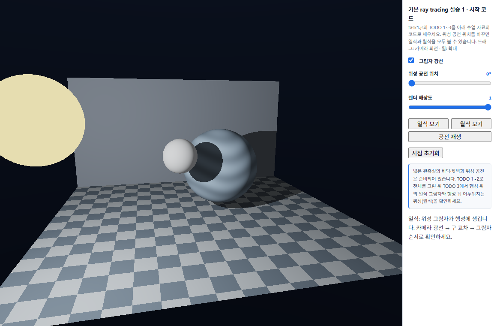
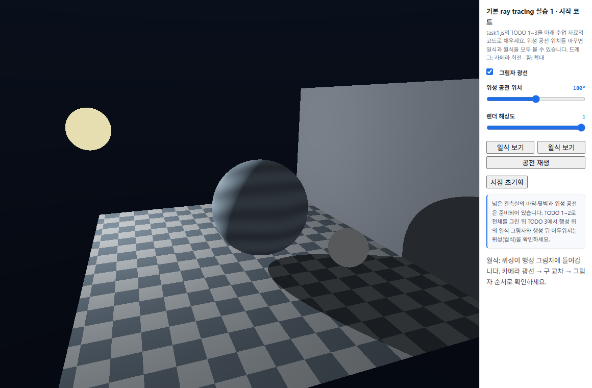

# 7주차 보고서

- 이름: 강진영
- 저장소: https://github.com/tqwuis/cg-solar
- GitHub Pages 실행: [Task 1](https://tqwuis.github.io/cg-solar/week7/week07-raytrace-starter/task1.html)

## Task 1

광선 추적으로 **일식과 월식**을 렌더링하고, 위성의 공전 위치에 따라 어느 천체에 그림자가 생기는지 비교했다. 구현 코드는 [task1.js](week07-raytrace-starter/task1.js)에 있다.

### 공전 위치에 따른 일식과 월식 비교

그림자 광선을 켠 상태에서 **일식 보기**와 **월식 보기**를 눌러 각 장면을 캡처했다.

#### 일식 — 공전 위치 0°

0°에서는 별과 행성 사이에 위성이 놓인다. 파란 행성의 밝은 면에 생긴 둥근 그림자는 위성이 별빛을 가린 영역이다. 그림자 광선을 끄면 이 영역도 주변처럼 직접광을 받아 둥근 그림자가 사라진다.

#### 월식 — 공전 위치 180°

위성이 반 바퀴 돌면 별과 위성 사이에 행성이 놓인다. 이번에는 행성이 별빛을 가려 위성이 어두워진다. 위성에는 약한 주변광이 남아 윤곽을 볼 수 있다. 그림자 광선을 끄면 별을 향한 위성 표면이 다시 직접광을 받는다.

### 그림자 광선의 역할

카메라 광선은 픽셀마다 가장 가까운 교차점을 찾아 화면에 보일 표면을 정한다. 셰이더는 그 지점에서 별의 중심을 향해 그림자 광선을 보낸다. 출발점을 표면 법선 방향으로 조금 옮겨 자기 표면을 다시 맞히는 오류를 피한다. 별에 닿기 전에 다른 천체에 막히면 해당 지점의 직접광을 0으로 두고 주변광만 남긴다. 그림자 광선을 꺼도 표면이 별을 향하는 각도에 따른 명암은 유지된다.

## Task 2

실습 2에는 서로 다른 기기 2개 이상의 비교를 넣습니다. 
각 기기의 공통 조건과 가장 느리게 시험한 조건, 스스로 정한 적정 조건을 아래처럼 기록하고, 왜 기기별 설정을 다르게 정했는지 분석합니다. 
GPU 모델을 확인할 수 없으면 ‘확인 불가’라고 적어도 됩니다.

두 기기의 week7/task2.html 접속 화면과 새로고침 후 자동 선택된 설정을 캡처
